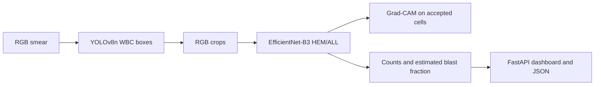

# Explainable Deep Learning Framework for Automated Leukemia Blast Cell Detection in Blood Smears

**Research-content guide, 13 October 2026.** This guide describes the implemented repository and measured results. Adapt the shorter [paper draft](CONFERENCE_PAPER_DRAFT.md) to the selected venue's actual template. The system is a research/assistive screening prototype, not a standalone diagnostic device. For exact tables and artifact paths see [RESULTS_TABLES.md](RESULTS_TABLES.md), for source-checked bibliography see [REFERENCES.md](REFERENCES.md), and for image provenance see [FIGURE_CAPTIONS.md](FIGURE_CAPTIONS.md).

## 1. Project overview

Peripheral-smear examination helps clinicians assess blood-cell morphology during leukemia workups. It requires expert microscopy and broader clinical/laboratory context; an image classifier alone cannot confirm acute lymphoblastic leukemia (ALL). This project combines WBC localization, cell-level HEM/ALL classification, visual model attribution and an estimated fraction of predicted blasts in a local FastAPI dashboard. The separate models are trained on two different datasets. The evidence establishes detector performance on BCCD and cell-classifier performance on C-NMC; it does not establish clinical diagnostic or whole-smear blast-detection performance.

## 2. Publication abstract and keywords

**Abstract—** Leukocyte localization and blast-like cell recognition could support peripheral blood-smear review, but separately collected microscopy datasets complicate evaluation of integrated systems. We implemented a two-stage research prototype in which YOLOv8n localizes white blood cells (WBCs), and a fully fine-tuned EfficientNet-B3 labels cropped cells as normal (HEM) or leukemic blast (ALL). Grad-CAM supplies post-hoc image attribution, and a FastAPI interface counts accepted predictions to estimate a blast fraction. The WBC detector was trained using 205 BCCD images and evaluated on 72 test images, attaining precision 0.9450, recall 1.0000, mAP@0.5 0.9646, and mAP@0.5:0.95 0.7707. The classifier was trained on subject-disjoint C-NMC partitions and evaluated on 3,553 fold_2 cells from 31 subjects. Relative to the earlier baseline, full fine-tuning increased cell-level accuracy from 0.7748 to 0.8382 and ROC-AUC from 0.7205 to 0.8434. At its validation-selected threshold of 0.05, the full model achieved blast sensitivity 0.9654, normal specificity 0.5529, and macro-F1 0.7851. The baseline used threshold 0.50, so operating-point changes reflect both weights and threshold. An exploratory unweighted-loss continuation improved test specificity to 0.6414 but reduced sensitivity to 0.9214; it was not deployed. BCCD lacks blast labels, and C-NMC contains segmented cells. Thus integrated leukemia detection and estimated blast fractions lack quantitative whole-smear validation, while the classifier's low normal specificity and prior test exposure limit generalization claims.

**Keywords—** acute lymphoblastic leukemia; peripheral blood smear; WBC detection; YOLOv8n; EfficientNet-B3; Grad-CAM.

## 3. Introduction

ALL involves malignant lymphoblasts and requires laboratory and clinical assessment beyond image appearance. Peripheral blood smears expose leukocyte morphology, but manual cell review is time consuming and requires expertise. Computer vision may assist by proposing WBC locations, ranking suspicious cells and keeping image-linked explanations. Pre-cropped-cell classifiers omit localization and counting. Visual attribution can help inspect model focus but cannot establish biological validity. Our objective is to connect a WBC detector and binary cell classifier in a transparent prototype while reporting each task's evidence separately.

## 4. Existing systems and related work

Microscopy remains part of expert hematologic assessment; automatic systems commonly learn from segmented cell images, which do not reproduce an entire smear. Nunes *et al.* studied YOLOv8-based **classification** of peripheral-smear cancer cells [1]. Dasaramoole Prakash *et al.* proposed an altered YOLOv8 architecture with residual attention for leukemia-related detection/classification [2]. Those published task definitions and datasets differ from ours, so their performance numbers are not directly comparable. EfficientNet introduces compound scaling of network depth, width and resolution [4]. Grad-CAM localizes features influential to a CNN output [3]. Our implementation uses a standard single-class YOLOv8n **detector** for WBC boxes followed by a separate Torchvision EfficientNet-B3 binary classifier. The related papers do not validate this particular combination.

## 5. Proposed system

**Fig. 1.** An RGB smear is passed to YOLOv8n for WBC boxes; retained crops are classified by EfficientNet-B3. Accepted cells can receive Grad-CAM overlays. Counts and an estimated blast fraction are returned in JSON and the local dashboard. The arrow denotes software integration, not measured end-to-end diagnostic accuracy.

The detector receives a smear image and outputs confidence-scored WBC boxes. Coordinates are clipped and duplicate boxes filtered before RGB crops are made. The classifier returns a blast score; its checkpoint carries the decision threshold. Scores close to that threshold or crops smaller than 16 pixels on the shortest side are unclassified. Accepted cells can be attributed with Grad-CAM. The output contains boxes, cell labels, scores, counts, source/checkpoint hashes and warnings. Implementation: `src/integrated_pipeline.py` and `src/dashboard.py`.

## 6. Datasets and preparation

| Dataset | Recorded task | Local split | Labels | Important boundary |
|---|---|---|---|---|
| BCCD [7], local Kaggle JSON export | WBC localization | 205 train / 87 val / 72 test images; 372 WBC boxes total | Source includes RBC, WBC and platelet rectangles; processing keeps WBC only | No reliable ALL/HEM blast labels |
| C-NMC-2019 [5], [6] | Segmented-cell binary classification | 4,667 train / 1,185 val / 3,553 fold_2 test cells; 30 / 8 / 31 subjects | 0=Normal/HEM; 1=Blast/ALL | Not whole-smear object boxes |

The official labeled C-NMC training collection contains 7,272 ALL and 3,389 HEM images (10,661 total); the local experiment's usable partitions above are defined by saved manifests. BCCD source rectangles were converted to normalized YOLO WBC boxes using the actual image dimensions; original Kaggle split membership was preserved. The processed split contains 214/87/71 WBC boxes for train/validation/test. C-NMC uses subject-disjoint partitions; fold_2 was reserved for testing, although it was examined during earlier baseline development. BCCD and C-NMC were never merged into a single supervised training dataset. Stain, segmentation and acquisition differences can shift classifier performance when fed YOLO crops.

**Fig. 5.** BCCD teaches WBC bounding boxes to YOLOv8n; C-NMC teaches HEM/ALL labels to EfficientNet-B3. Checkpoints meet only during inference.

## 7. YOLOv8n architecture and detection experiment

**Fig. 2.** Simplified YOLOv8n detector: convolution/C2f backbone, SPPF, top-down and bottom-up feature fusion, and an anchor-free decoupled detection head over three scales [8]. The figure abstracts layer counts and is not a network graph from the checkpoint.

The 640-pixel input passes through convolutional and C2f stages. SPPF supplies larger-context features. The neck combines P3/P4/P5 features through FPN-like top-down and PAN-like bottom-up paths. The anchor-free head predicts box distributions and class scores; non-maximum suppression (NMS) removes overlapping detections before crops are extracted. The single target class is WBC. The trained checkpoint began from `yolov8n.pt`, a compact variant appropriate for the recorded 4 GiB GPU. It ran for 50 epochs with actual batch 16, AMP and two workers. `results.csv` logs box, classification and distribution-focal losses. The saved effective configuration does not separately establish a fully resolved optimizer/augmentation schedule, so avoid claiming a particular optimizer or mosaic probability.

For ground-truth box matching, intersection-over-union is $IoU=|B_p\cap B_g|/|B_p\cup B_g|$. Detection precision is $TP/(TP+FP)$ and recall is $TP/(TP+FN)$ at the evaluator's operating settings. Average precision integrates its precision-recall curve; mAP@0.5 uses IoU 0.5, while mAP@0.5:0.95 averages IoU thresholds 0.50 through 0.95. On the 72-image BCCD test set: precision **0.9450**, recall **1.0000**, mAP@0.5 **0.9646**, mAP@0.5:0.95 **0.7707** (`outputs/paper_results/detection_metrics.json`). These values measure WBC localization only.

## 8. EfficientNet-B3 architecture and full fine-tuning

**Fig. 3.** Torchvision EfficientNet-B3 receives a 224 × 224 RGB cell crop, uses a convolutional stem and MBConv stages, global pooling and a two-logit head. The lower row expands an MBConv block: pointwise expansion, depthwise convolution, squeeze-and-excitation (SE), projection and an optional residual path [4], [9].

EfficientNet compound scaling adjusts depth, width and resolution [4]. MBConv's depthwise operation reduces convolution cost; SE reweights channels. `src/classifier_model.py` replaces the pretrained classification layer with two outputs. Class 0 denotes HEM; class 1 denotes ALL blast. The project chose B3 as a practical pretrained capacity/compute compromise, without a local controlled comparison to other CNN families. Torchvision's published pretrained evaluation recipe uses a 300-pixel crop [9], whereas **this** checkpoint's explicit transform bicubically resizes each RGB crop to **224 × 224**, converts to a tensor and normalizes with mean `[0.485,0.456,0.406]` and std `[0.229,0.224,0.225]`. It does not apply a 300-pixel center crop.

The full run initialized from the saved baseline best weights, which originated from ImageNet initialization. Every feature block was trainable; BatchNorm running statistics were frozen. Training used AdamW, weighted cross-entropy with train-only inverse-frequency weights, learning rate $3\times10^{-5}$, weight decay $10^{-4}$, batch 4 and accumulation 2. Mild horizontal flip, ±10° rotation and ±8% brightness/contrast were applied to training cells. Twenty epochs completed; validation macro-F1 selected epoch 16. A validation macro-F1 threshold search selected 0.05, its lower boundary. See full-run `training_config.json`, `training_history.csv`, `threshold_config.json`, and `src/classifier_transforms.py`.

## 9. Grad-CAM

**Fig. 4.** A trained classifier is differentiated with respect to its last spatial feature map; channel weights form a rectified heatmap that is resized and overlaid on the original cell [3]. Grad-CAM is post-hoc and is not trained as a separate model.

For target class $c$, feature map channel $k$, and spatial locations $(i,j)$, the channel weight and heatmap are

$$\alpha_k^c=\frac{1}{Z}\sum_i\sum_j\frac{\partial y^c}{\partial A_{ij}^k},\qquad L_{\mathrm{GradCAM}}^c=\mathrm{ReLU}\!\left(\sum_k\alpha_k^c A^k\right).$$

Here $y^c$ is the class logit, $A^k$ is a convolutional activation map and $Z$ its number of spatial locations. The implementation uses the last spatial EfficientNet feature layer, gradients, a class-targeted map, resize and RGB overlay (`src/classifier_gradcam.py`). The saved four-category gallery below contains correct normal, correct blast, false-positive normal and false-negative blast **from the baseline checkpoint at threshold 0.50**. Its metadata is `outputs/classifier/gradcam/gradcam_summary.json`; it is not evidence of full-model Grad-CAM error distribution. Separate full-model validation examples exist in `outputs/classifier/improvement_audit/`. A highlighted area shows model influence, not medically verified nucleoli or chromatin.

## 10. Complete inference pipeline

**Fig. 6.** Validated image bytes are decoded to RGB, passed to YOLO NMS and a defensive IoU 0.7 duplicate filter. Clipped WBC crops receive the classifier's saved preprocessing and threshold; accepted predictions can receive Grad-CAM, then JSON and dashboard output.

`decode_image` rejects empty, oversized or damaged uploads. Ultralytics prediction applies confidence 0.25 and NMS IoU 0.7 by dashboard default; a second confidence-sorted filter drops duplicate boxes with IoU at least 0.7. Crops are RGB, default margin zero. EfficientNet computes softmax blast scores; the full checkpoint threshold is 0.05. Cells within 0.05 of that threshold or with a crop side under 16 pixels are unclassified. The model score is uncalibrated. Grad-CAM is calculated only for accepted cells when enabled. The report records detector/classifier hashes, count totals and all cell decisions. The saved BCCD example `outputs/inference/smear_20261013T151756Z_6c85e10b/report.json` uses the **full checkpoint** but has no blast ground truth. The reproduced image below is its actual saved annotation, **not a browser screenshot**.

## 11. Quantification

**Fig. 7.** Count retained WBC boxes and accepted HEM/ALL classifications; exclude unclassified cells from the fraction denominator. Return null when no cell is accepted.

The software reports detected WBCs, accepted classified WBCs, predicted normal, predicted blast and unclassified. Ultralytics NMS and the secondary overlap filter precede counting. With $N_v=N_{normal}+N_{blast}$, the estimate is $100N_{blast}/N_v$ when $N_v>0$, otherwise null. **Illustration only:** if 20 accepted cells comprise 15 Normal and 5 Blast, the arithmetic yields 25%. **Saved software demonstration:** the full-model BCCD report identified 4 WBCs, accepted 2, predicted 2 blasts and left 2 unclassified, giving 100% of accepted cells. BCCD supplies no blast truth, so neither value establishes a clinically accurate blast percentage or disease severity.

## 12. Experimental setup

The saved environment reports Windows 10 build 26200, Python 3.11.17 in the `leukemia-yolo` Conda environment, PyTorch 2.14.1+cu126, Torchvision 0.29.1+cu126, Ultralytics 8.4.176, NVIDIA GeForce RTX 3050 Ti Laptop GPU with 4 GiB dedicated VRAM, and 15.73 GiB RAM. The CPU model is **not verified** in the saved reports. YOLO ran 50 epochs at 640 pixels, actual batch 16, about 272.76 seconds. EfficientNet full fine-tuning ran 20 epochs at 224 pixels, physical batch 4/accumulation 2, measured epoch time 2,333.139 seconds (~38.9 minutes), peak allocated CUDA memory about 538 MiB. The detector test and classifier fold_2 evaluation were separate. Use the checkpoint hashes and split fingerprint in [RESULTS_TABLES.md](RESULTS_TABLES.md) when archiving the experiment.

## 13. EfficientNet classification results

The full model's C-NMC fold_2 confusion matrix is **TN 606, FP 490, FN 85, TP 2,372** (3,553 cells; 31 subjects). Positive class is ALL blast. Thus accuracy $(606+2372)/3553=0.8382$, sensitivity $2372/(2372+85)=0.9654$ and specificity $606/(606+490)=0.5529$. Balanced accuracy is 0.7592, macro-F1 0.7851 and ROC-AUC 0.8434. The baseline accuracy was 0.7748, sensitivity 0.9292, specificity 0.4288, macro-F1 0.6956 and ROC-AUC 0.7205. Baseline threshold **0.50** and full threshold **0.05** differ; operating-point comparisons therefore combine the change in weights with the change in threshold. A separate reporting-only common-threshold analysis exists in `outputs/classifier/improvement_audit/test_fair_comparison_reporting_only.json`; it was not used to select deployment settings. ROC-AUC does not depend on a chosen decision threshold.

These curves are copied from the actual full-run test plots and review history. The fold_2 set had prior development exposure, so call it a previously examined internal test set rather than an untouched external test.

## 14. Further improvement experiments

Three controlled continuations from the same full checkpoint were selected on the development validation split using maximum specificity subject to at least 0.95 blast sensitivity. Validation specificity/sensitivity were 0.926/0.951 for unchanged policy, 0.919/0.953 for mild augmentation and 0.933/0.951 for unweighted loss. Only the validation-selected unweighted arm received a qualified fold_2 evaluation: specificity 0.6414 and sensitivity 0.9214, with 703 TN, 393 FP, 193 FN and 2,264 TP. It improved specificity by 8.85 percentage points over the retained full checkpoint but introduced **108 more missed blasts**, breaching the study's 0.95 sensitivity requirement. The full checkpoint remains dashboard default. The validation split has only two normal subjects, making the initial validation ranking fragile. These are exploratory internal results, not external validation (`outputs/classifier/improvements/qualified_comparison.json`).

## 15. Results and discussion

WBC localization on BCCD is strong under its own box annotations (mAP@0.5 0.9646), but it does not identify blasts. On segmented C-NMC cells, full fine-tuning raised ROC-AUC from 0.7205 to 0.8434 and accuracy from 0.7748 to 0.8382 under differing thresholds. The full classifier correctly identified 2,372 blast cells and missed 85; it correctly recognized 606 normals but falsely flagged 490. The latter yields only 55.3% normal specificity, a substantial false-alarm burden. Validation specificity at the saved threshold was about 86.7%, well above fold_2's 55.3%; only two normal validation subjects were present. Domain and subject differences are plausible contributors, but the present data cannot prove a causal mechanism. The Grad-CAM panels expose visual attribution and failures, without independent expert annotation of cell structures. Counting and the dashboard are implemented and demonstrated on BCCD examples, but no whole-smear ALL labels establish end-to-end sensitivity, specificity or blast-fraction error.

## 16. Limitations

- BCCD and C-NMC differ in image distribution, acquisition and annotation; BCCD supplies WBC boxes but no leukemia blast labels, while C-NMC supplies segmented single cells rather than whole smears.
- The integrated detector-classifier system has no quantitative leukemia-labeled whole-smear evaluation. Saved outputs show functionality only.
- Normal specificity on fold_2 is 0.5529, and both 490 false positives and 85 false negatives remain.
- The test fold was previously examined in development; the results are not a fresh independent or prospective estimate.
- Only two normal subjects appear in validation. Threshold 0.05 lies at the earlier search floor; neither softmax scores nor estimated fractions are calibrated.
- Grad-CAM attribution has no expert-verified morphologic interpretation; model attention cannot validate biology.
- Estimated blast fraction excludes unclassified detections and has no ground-truth fraction evaluation. This research prototype is not standalone clinical diagnosis.

## 17. Conclusion

The project delivers a functioning YOLOv8n WBC detector, EfficientNet-B3 cell classifier, Grad-CAM visualization, quantification logic and FastAPI interface. Measured BCCD WBC localization reached mAP@0.5 0.9646; measured C-NMC fold_2 cell classification reached accuracy 0.8382 and ROC-AUC 0.8434 after full fine-tuning. The low normal specificity, prior test exposure and absence of labeled whole-smear validation prevent clinical-reliability claims. The implementation is a foundation for research evaluation of the combined pipeline.

## 18. Future scope

Prospective work should collect leukemia-labeled whole-smear boxes and cell labels; evaluate detection-to-classification errors and blast-fraction error; include more normal subjects and independent institutions; perform true subject-wise cross-validation with fresh initialization per fold; explore domain adaptation and stain variation; assess score calibration; and ask hematology experts to review Grad-CAM maps. Improve deployment only after those measurements. None of these evaluations is reported as completed here.

## 19. References

Use the numbered, verified bibliography in [REFERENCES.md](REFERENCES.md): [1] Nunes *et al.*, [2] Dasaramoole Prakash *et al.*, [3] Selvaraju *et al.*, [4] Tan and Le, [5] C-NMC collection, [6] C-NMC dataset paper, [7] BCCD repository, [8] Ultralytics architecture documentation, [9] Torchvision B3 documentation. Cite [1] only for its own classification study; cite local artifact paths for project results.

## 20. What belongs in a 5–8-page paper

| Paper part | Essential content | Suggested visual |
|---|---|---|
| Abstract | Tasks, two datasets, exact test metrics, limits | None |
| Introduction/related work | Clinical motivation; distinction from YOLOv8 classification work [1] | None |
| Method | Separate data flows, YOLO detector, EfficientNet classifier, Grad-CAM, quantification | Fig. 1 plus one compact architecture panel (Figs. 2–4) |
| Experimental setup | Subject-disjoint partition, preprocessing, checkpoints, thresholds, hardware | Dataset/config table |
| Results | BCCD detector metrics, C-NMC confusion matrix, ROC-AUC, baseline comparison | Detection chart, classifier confusion matrix, ROC |
| Discussion | 55.3% specificity, prior fold exposure, domain shift, illustrative integrated output | One clearly qualified Grad-CAM panel or integrated example |
| Conclusion | Supported findings and next validation | None |

Venue page limit and formatting are **not verified**; check the target call for papers. The longer figure set is suitable for a supplement or presentation. Figure order: Fig. 1 system → Fig. 5 data flow → Figs. 2–3 models → Fig. 4 Grad-CAM → Fig. 6 inference → Fig. 7 quantification → result plots. Avoid implying diagram numbering itself determines the venue layout.
